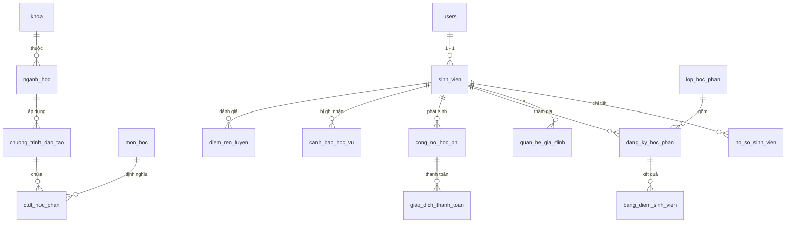
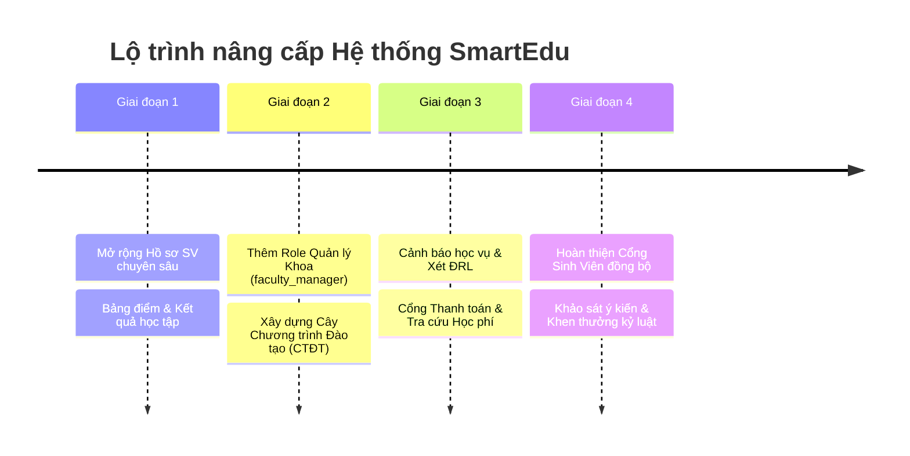

# KẾ HOẠCH PHÂN TÍCH & THIẾT KẾ CƠ SỞ DỮ LIỆU MỞ RỘNG CHO HỆ THỐNG SMARTEDU

> **Dự án**: SmartEdu - Hệ thống Quản lý Đào tạo & Điểm danh Nhận diện Khuôn mặt Face AI  
> **Tài liệu**: Đề án mở rộng cơ sở dữ liệu nghiệp vụ đại học & Phân quyền Quản lý Khoa  
> **Căn cứ tham chiếu**: Cổng thông tin đào tạo sinh viên đại học (UniSoft / Edusoft)

---

## 1. TỔNG QUAN YÊU CẦU & BỐI CẢNH

Hệ thống hiện tại của SmartEdu đã có nền tảng cốt lõi rất vững chắc gồm:
* Quản lý người dùng, giảng viên, sinh viên, khoa, lớp sinh hoạt, môn học, lớp học phần, học kỳ.
* Điểm danh thông minh Face AI + GPS, lịch giảng dạy timeline realtime.
* Quản lý ca thi và phòng thi.

Để nâng cấp hệ thống trở thành một **Nền tảng Quản trị Đại học Toàn diện (University ERP)** tương tự như hệ thống Cổng Sinh viên thực tế (hình ảnh cung cấp), hệ thống cần tích hợp thêm các phân hệ:
1. **Sơ yếu lý lịch & Hồ sơ sinh viên chuyên sâu** (Thông tin cá nhân chi tiết, gia đình, cư trú, tuyển sinh, giấy tờ).
2. **Khung Chương trình đào tạo (CTĐT)** (Ngành, khối kiến thức, tiên quyết, song hành).
3. **Đăng ký học phần hoàn chỉnh** (Đợt đăng ký, quy chế tín chỉ min/max, hủy môn, học cải thiện).
4. **Học phí & Thanh toán điện tử** (Biểu phí, công nợ, hóa đơn, cổng thanh toán).
5. **Cảnh báo học vụ & Xét tốt nghiệp** (Mức 1, 2, buộc thôi học theo tín chỉ/GPA).
6. **Bảng điểm & Kết quả học tập** (Điểm thành phần, hệ 10, hệ 4, điểm chữ, GPA/CPA).
7. **Đánh giá Điểm rèn luyện** (Tiêu chí chấm điểm từng kỳ, minh chứng hoạt động).
8. **Khen thưởng, Kỷ luật & Ý kiến sinh viên**.

---

## 2. PHÂN TÍCH THIẾT KẾ CÁC BẢNG DỮ LIỆU MỚI (DATABASE SCHEMA)

---

### PHÂN HỆ 1: SƠ YẾU LÝ LỊCH & HỒ SƠ SINH VIÊN CHUYÊN SÂU

Hiện tại bảng `sinh_vien` mới chỉ có các thông tin cơ bản (`ma_sv`, `ho_ten`, `ngay_sinh`, `gioi_tinh`, `email`, `lop_id`, `avatar_url`, `face_embedding`). Để đáp ứng toàn bộ các trường như trong biểu mẫu "CẬP NHẬT HỒ SƠ" (hình ảnh), nên tách thành 2 bảng chuyên biệt để tránh phình to bảng chính:

#### 1.1. Bảng `ho_so_sinh_vien` (Mở rộng lý lịch cá nhân)
* **Mục đích**: Lưu trữ thông tin hộ tịch, cư trú, căn cước, đối tượng chính sách.
* **Cấu trúc trường**:
  * `id`: BIGINT, PK, Auto Increment.
  * `sinh_vien_id`: INT, FK -> `sinh_vien(id)`, UNIQUE.
  * `so_cmnd_cccd`: VARCHAR(20), số CCCD/CMND.
  * `ngay_cap`: DATE, nơi cấp.
  * `noi_sinh`: VARCHAR(100), quê quán `que_quan`: VARCHAR(255).
  * `dan_toc`: VARCHAR(50) (Kinh, Tày, Nùng...).
  * `ton_giao`: VARCHAR(50) (Không, Phật giáo, Công giáo...).
  * `quoc_tich`: VARCHAR(50) DEFAULT 'Việt Nam'.
  * `thanh_phan_xuat_than`: VARCHAR(100) (Nông dân, Công chức, Kinh doanh...).
  * `ngay_vao_doan`: DATE, `ngay_vao_dang`: DATE.
  * `so_dien_thoai_ca_nhan`: VARCHAR(15).
  * `so_dien_thoai_gia_dinh`: VARCHAR(15).
  * `dia_chi_thuong_tru`: TEXT (Số nhà, đường, thôn xóm).
  * `xa_phuong`: VARCHAR(100), `quan_huyen`: VARCHAR(100), `tinh_thanh_pho`: VARCHAR(100).
  * `dia_chi_tam_tru_hien_nay`: TEXT (Ký túc xá / Trọ ngoại trú).
  * `doi_tuong_chinh_sach`: VARCHAR(100) (Con thương binh, hộ nghèo, vùng cao...).
  * `doi_tuong_tro_cap`: VARCHAR(100).
  * `dia_chi_bao_tin`: TEXT (Người nhận tin tức từ nhà trường khi có việc gấp).

#### 1.2. Bảng `quan_he_gia_dinh` (Thân nhân sinh viên)
* **Mục đích**: Quản lý mối quan hệ Bố, Mẹ, Người giám hộ như trên cổng đào tạo.
* **Cấu trúc trường**:
  * `id`: BIGINT, PK.
  * `sinh_vien_id`: INT, FK -> `sinh_vien(id)`.
  * `moi_quan_he`: ENUM('Cha', 'Me', 'NguoiGiamHo', 'AnhChiEm').
  * `ho_ten`: VARCHAR(150), `nam_sinh`: INT.
  * `nghe_nghiep`: VARCHAR(150), `co_quan_lam_viec`: VARCHAR(255).
  * `so_dien_thoai`: VARCHAR(15), `dia_chi_hien_nay`: TEXT.

#### 1.3. Bảng `thong_tin_tuyen_sinh` (Hồ sơ trúng tuyển)
* **Cấu trúc trường**:
  * `id`: INT, PK.
  * `sinh_vien_id`: INT, FK -> `sinh_vien(id)`, UNIQUE.
  * `phuong_thuc_xet_tuyen`: VARCHAR(100) (Thi THPT, Học bạ, ĐGNL, Xét tuyển thẳng).
  * `khoi_thi`: VARCHAR(10) (A00, A01, D01...).
  * `diem_xet_tuyen`: FLOAT, `diem_uu_tien`: FLOAT.
  * `nam_tot_nghiep_c3`: INT, `truong_thpt`: VARCHAR(255).
  * `so_bao_danh`: VARCHAR(50).

---

### PHÂN HỆ 2: CHƯƠNG TRÌNH ĐÀO TẠO (CTĐT KHUNG)

Hiện tại hệ thống chỉ có bảng `mon_hoc` riêng rẽ và bảng `khoa`. Chưa có cấu trúc phân chia Ngành đào tạo và Cây kiến trúc môn học theo khung thời gian.

#### 2.1. Bảng `nganh_hoc` (Ngành đào tạo)
* **Cấu trúc trường**:
  * `id`: INT, PK.
  * `khoa_id`: INT, FK -> `khoa(id)`.
  * `ma_nganh`: VARCHAR(20) UNIQUE (VD: `7480201` - CNTT, `7480108` - KHMT).
  * `ten_nganh`: VARCHAR(150).
  * `thoi_gian_dao_tao_nam`: FLOAT DEFAULT 4.0.
  * `tong_tin_chi_yeu_cau`: INT DEFAULT 135.

#### 2.2. Bảng `chuong_trinh_dao_tao` (Khung CTĐT theo Khóa & Khoa)
* **Mục đích**: Mỗi khóa (K22, K23, K24) áp dụng một khung CTĐT khác nhau và **phụ thuộc trực tiếp vào từng Khoa quản lý** để phục vụ việc phân quyền Quản lý Khoa.
* **Cấu trúc trường**:
  * `id`: INT, PK, Auto Increment.
  * `khoa_id`: INT, FK -> `khoa(id)` (Khoa quản lý và ban hành khung).
  * `nganh_hoc_id`: INT, FK -> `nganh_hoc(id)`.
  * `ma_ctdt`: VARCHAR(50) UNIQUE (VD: `CTDT_CNTT_K23`).
  * `ten_ctdt`: VARCHAR(255).
  * `khoa_tuyen_sinh`: VARCHAR(20) (VD: `K23`, `K24`).
  * `nam_ban_hanh`: INT.
  * `quyet_dinh_ban_hanh`: VARCHAR(255).
  * `tong_tin_chi_yeu_cau`: INT DEFAULT 135.
  * `is_active`: BOOLEAN DEFAULT TRUE.

#### 2.3. Bảng `ctdt_hoc_phan` (Chi tiết các môn trong khung CTĐT)
* **Cấu trúc trường**:
  * `id`: BIGINT, PK.
  * `chuong_trinh_dao_tao_id`: INT, FK -> `chuong_trinh_dao_tao(id)`.
  * `mon_hoc_id`: INT, FK -> `mon_hoc(id)`.
  * `hoc_ky_goi_y`: INT (Kỳ 1, 2, ..., 8).
  * `khoi_kien_thuc`: ENUM('DaiCuong', 'CoSoNganh', 'ChuyenNganh', 'TotNghiep').
  * `loai_hoc_phan`: ENUM('BatBuoc', 'TuChon').
  * `mon_tien_quyet_id`: INT NULL (Môn phải qua trước khi học môn này).
  * `mon_song_hanh_id`: INT NULL (Môn có thể học cùng kỳ).

---

### PHÂN HỆ 3: ĐĂNG KÝ HỌC PHẦN NÂNG CAO

Dự án đã có bảng `dang_ky_hoc_phan`. Cần mở rộng thêm các bảng điều phối kỳ đăng ký:

#### 3.1. Bảng `dot_dang_ky_hoc_phan` (Cổng đăng ký theo đợt)
* **Mục đích**: Kiểm soát thời gian mở cổng đăng ký tín chỉ online cho sinh viên.
* **Cấu trúc trường**:
  * `id`: INT, PK.
  * `hoc_ky_id`: INT, FK -> `hoc_ky(id)`.
  * `ten_dot`: VARCHAR(150) (VD: "Đợt 1 - Đăng ký chính thức HK1 2026-2027").
  * `thoi_gian_bat_dau`: DATETIME, `thoi_gian_ket_thuc`: DATETIME.
  * `tin_chi_toi_thieu`: INT DEFAULT 12, `tin_chi_toi_da`: INT DEFAULT 24.
  * `trang_thai`: ENUM('ChuaMo', 'DangMo', 'DaDong', 'Huy').
  * `ap_dung_khoa`: VARCHAR(50) (Có thể mở ưu tiên K21 trước, K23 sau).

#### 3.2. Cải tiến bảng `dang_ky_hoc_phan`
* Bổ sung các cột:
  * `dot_dang_ky_id`: INT, FK -> `dot_dang_ky_hoc_phan(id)`.
  * `trang_thai_dang_ky`: ENUM('ThanhCong', 'ChoXetDuyet', 'DaHuy', 'HocLai', 'HocCaiThien').
  * `ngay_huy`: DATETIME NULL.
  * `ly_do_huy`: VARCHAR(255).

---

### PHÂN HỆ 4: THANH TOÁN HỌC PHÍ & QUẢN LÝ CÔNG NỢ

#### 4.1. Bảng `dinh_muc_hoc_phi` (Đơn giá tín chỉ)
* **Cấu trúc trường**:
  * `id`: INT, PK.
  * `hoc_ky_id`: INT, FK -> `hoc_ky(id)`.
  * `nganh_hoc_id`: INT, FK -> `nganh_hoc(id)`.
  * `don_gia_tin_chi_ly_thuyet`: DECIMAL(12, 2) (VD: 450.000 VNĐ / TC).
  * `don_gia_tin_chi_thuc_hanh`: DECIMAL(12, 2) (VD: 600.000 VNĐ / TC).

#### 4.2. Bảng `cong_no_hoc_phi` (Quản lý công nợ & Xác nhận từ Phòng Kế toán)
* **Cấu trúc trường**:
  * `id`: BIGINT, PK, Auto Increment.
  * `sinh_vien_id`: INT, FK -> `sinh_vien(id)`.
  * `hoc_ky_id`: INT, FK -> `hoc_ky(id)`.
  * `tong_tin_chi_dang_ky`: INT.
  * `tong_hoc_phi_phai_nop`: DECIMAL(14, 2).
  * `so_tien_mien_giam`: DECIMAL(14, 2) DEFAULT 0.
  * `so_tien_da_dong`: DECIMAL(14, 2) DEFAULT 0.
  * `so_tien_con_no`: DECIMAL(14, 2) DEFAULT 0.
  * `han_chot_nop`: DATE.
  * `trang_thai`: ENUM('ChuaDong', 'DongMotPhan', 'DaHoanThanh', 'QuaHan', 'ChoKiemDuyet').
  * `ngay_nop_tien`: DATETIME NULL.
  * `nguoi_xac_nhan_id`: INT NULL, FK -> `users(id)` (Cán bộ kế toán/Admin kiểm tra và xác nhận).
  * `ngay_xac_nhan`: DATETIME NULL.
  * `so_bien_lai`: VARCHAR(100) NULL.
  * `ghi_chu_ke_toan`: TEXT NULL (Lưu vết kiểm tra giao dịch hoặc nộp trực tiếp tại phòng Kế toán).

> **Lưu ý nghiệp vụ**: Bảng `giao_dich_thanh_toan` (Cổng thanh toán tự động VNPAY/Momo) tạm thời chưa triển khai giai đoạn này theo yêu cầu; thực tế sinh viên nộp về phòng kế toán hoặc chuyển khoản ngân hàng nhà trường, sau đó cán bộ kế toán đối soát và cập nhật xác nhận trực tiếp trên bảng `cong_no_hoc_phi`.

---

### PHÂN HỆ 5: BẢNG ĐIỂM, KẾT QUẢ HỌC TẬP & CẢNH BÁO HỌC VỤ

#### 5.1. Bảng `bang_diem_sinh_vien` (Điểm chi tiết từng môn)
* **Mục đích**: Tính điểm chuyên cần (tự động link từ Face AI), điểm bài tập, thi giữa kỳ, cuối kỳ.
* **Cấu trúc trường**:
  * `id`: BIGINT, PK.
  * `dang_ky_hoc_phan_id`: BIGINT, FK -> `dang_ky_hoc_phan(id)`.
  * `diem_chuyen_can`: FLOAT (Link từ tỷ lệ điểm danh nhận diện khuôn mặt).
  * `diem_giua_ky`: FLOAT, `diem_cuoi_ky`: FLOAT.
  * `diem_tong_ket_he10`: FLOAT (VD: 0.1 * CC + 0.3 * GK + 0.6 * CK).
  * `diem_tong_ket_he4`: FLOAT (VD: 4.0, 3.5, 3.0...).
  * `diem_chu`: VARCHAR(5) (A+, A, B+, B, C, D, F).
  * `ket_qua`: ENUM('Dat', 'KhongDat').

#### 5.2. Bảng `tong_ket_hoc_ky` (GPA & CPA tích lũy)
* **Cấu trúc trường**:
  * `sinh_vien_id`: INT, `hoc_ky_id`: INT (Composite PK).
  * `so_tin_chi_hoc_ky`: INT.
  * `gpa_he10`: FLOAT, `gpa_he4`: FLOAT.
  * `so_tin_chi_tich_luy`: INT.
  * `cpa_tich_luy_he4`: FLOAT.
  * `xep_loai_hoc_luc`: ENUM('XuatSac', 'Gioi', 'Kha', 'TrungBinh', 'Yeu', 'Kem').

#### 5.3. Bảng `canh_bao_hoc_vu` (Quyết định xử lý học vụ)
* **Mục đích**: Hệ thống quét tự động hoặc Khoa kích hoạt khi sinh viên có GPA < 2.0 hoặc nợ quá nhiều tín chỉ / vắng điểm danh quá 20%.
* **Cấu trúc trường**:
  * `id`: INT, PK.
  * `sinh_vien_id`: INT, FK -> `sinh_vien(id)`.
  * `hoc_ky_id`: INT, FK -> `hoc_ky(id)`.
  * `muc_canh_bao`: ENUM('NhacNho', 'CanhBao_Muc1', 'CanhBao_Muc2', 'BuocThoiHoc').
  * `ly_do`: TEXT (VD: "GPA kỳ 1 dưới 1.0; nợ môn vượt quá 12 tín chỉ; vắng điểm danh Face AI > 30%").
  * `ngay_ra_quyet_dinh`: DATE.
  * `so_quyet_dinh`: VARCHAR(100).
  * `trang_thai_khac_phuc`: ENUM('DangTheoDoi', 'DaKhacPhuc', 'ThiHanhKyLuat').

---

### PHÂN HỆ 6: ĐIỂM RÈN LUYỆN, KHEN THƯỞNG, KỶ LUẬT & Ý KIẾN

#### 6.1. Bảng `diem_ren_luyen`
* `sinh_vien_id`: INT, `hoc_ky_id`: INT.
* `diem_tu_danh_gia`: INT (Sinh viên tự chấm).
* `diem_lop_danh_gia`: INT (Cán bộ lớp chấm).
* `diem_khoa_duyet`: INT (Khoa thẩm định phê duyệt).
* `xep_loai`: ENUM('XuatSac', 'Tot', 'Kha', 'TrungBinh', 'Yeu', 'Kem').

#### 6.2. Bảng `khen_thuong_ky_luat`
* `sinh_vien_id`: INT, `loai`: ENUM('KhenThuong', 'KyLuat').
* `hinh_thuc`: VARCHAR(150) (Học bổng khuyến khích tài năng, Giấy khen, Khiển trách, Cảnh cáo...).
* `noi_dung`: TEXT, `so_quyet_dinh`: VARCHAR(100), `ngay_quyet_dinh`: DATE.

#### 6.3. Bảng `yeu_cau_chinh_sua_ho_so` & `y_kien_sinh_vien`
* Sinh viên bấm "Sửa TT cá nhân" hoặc "Gửi ý kiến" -> Gửi đơn kèm minh chứng -> Khoa/Phòng đào tạo duyệt và cập nhật.

---

## 3. TƯ VẤN: CÓ NÊN TẠO THÊM ROLE "QUẢN LÝ KHOA" (`faculty_manager`) KHÔNG?

### 👉 KẾT LUẬN: **RẤT NÊN VÀ CỰC KỲ KHẢ THI!**

Trong mô hình quản lý đại học thực tế tại Việt Nam, **Khoa là đơn vị quản trị học thuật & sinh viên trực tiếp nhất**. Việc dồn toàn bộ quyền vào tài khoản `admin` (Phòng Đào tạo) sẽ gây ra các bất cập:
1. **Quá tải**: Một trường có hàng chục khoa với hàng ngàn sinh viên; Admin trung tâm không thể nắm sát hoàn cảnh sinh viên để xét điểm rèn luyện, nhắc nhở học vụ, hoặc duyệt sửa hồ sơ cá nhân.
2. **Vi phạm nguyên tắc bảo mật phân quyền (Data Isolation)**: Giảng viên hoặc Trợ lý khoa CNTT không được phép nhìn thấy thông tin gia đình, học phí, kỷ luật của sinh viên Khoa Du lịch hay Khoa Kinh tế.

### BẢNG MA TRẬN PHÂN QUYỀN ĐỀ XUẤT (RBAC MATRIX)

| Chức năng / Phân hệ | Admin (Trường/P.ĐT) | Quản lý Khoa (`faculty_manager`) | Giảng viên (`teacher`) | Sinh viên (`student`) |
| :--- | :---: | :---: | :---: | :---: |
| **Cấu hình hệ thống & Học kỳ** | Toàn quyền (CRUD) | Chỉ xem | Chỉ xem | Chỉ xem |
| **Quản lý Khung CTĐT & Môn học** | Phê duyệt chung | Đề xuất & Xây dựng CTĐT của Khoa | Xem CTĐT giảng dạy | Xem CTĐT ngành mình học |
| **Sơ yếu lý lịch sinh viên** | Xem toàn trường | **Duyệt cập nhật hồ sơ SV trong Khoa** | Xem danh sách lớp dạy | Tự cập nhật, gửi yêu cầu duyệt |
| **Thời khóa biểu & Lớp học phần** | Điều phối toàn trường | Xếp giảng viên, chia ca trong Khoa | Xem lịch dạy, mở camera AI | Xem lịch học & phòng học |
| **Điểm số & Điểm danh** | Khóa sổ điểm | Giám sát & Mở khóa sửa điểm | Nhập điểm, kích hoạt điểm danh AI | Tra cứu bảng điểm cá nhân |
| **Cảnh báo học vụ** | Ký quyết định đuổi học | **Lập danh sách nhắc nhở & cảnh báo mức 1-2** | Theo dõi sinh viên vắng nhiều | Nhận thông báo cảnh báo |
| **Điểm rèn luyện** | Khóa kết quả toàn trường | **Hội đồng Khoa chấm duyệt chính thức** | Cố vấn học tập cho ý kiến | Tự đánh giá, nộp minh chứng |
| **Học phí & Thanh toán** | Quản lý định mức & kế toán | Xem tình trạng nợ phí SV khoa mình | Không xem | Xem nợ phí & Thanh toán online |

---

## 4. LỘ TRÌNH TRIỂN KHAI THEO TỪNG GIAI ĐOẠN (ROADMAP)

### Chi tiết các bước thực hiện:

#### 🔹 Giai đoạn 1: Mở rộng Hồ sơ cá nhân & Bảng điểm
1. Tạo bảng `ho_so_sinh_vien` và `quan_he_gia_dinh`.
2. Tạo bảng `bang_diem_sinh_vien`, liên kết tỷ lệ chuyên cần từ `lich_su_diem_danh` (Face AI) sang điểm thành phần.
3. Cập nhật trang Profile bên sinh viên với đầy đủ các tab như hình ảnh: *Thông tin cá nhân, Ngành học, Giấy tờ, Gia đình*.

#### 🔹 Giai đoạn 2: Tạo Role `faculty_manager` & Chương trình đào tạo
1. Thêm giá trị `'faculty_manager'` vào enum `role` trong bảng `users`.
2. Thêm cột `khoa_id` liên kết vào bảng hồ sơ quản lý khoa.
3. Tạo giao diện Layout `FacultyManagerLayout.jsx` với quyền hạn quản trị trong phạm vi Khoa.
4. Triển khai bảng `nganh_hoc`, `chuong_trinh_dao_tao`, `ctdt_hoc_phan`.

#### 🔹 Giai đoạn 3: Học phí & Cảnh báo học vụ
1. Triển khai bảng `cong_no_hoc_phi`, `giao_dich_thanh_toan`.
2. Viết trigger hoặc cron job tự động tính công nợ dựa trên số tín chỉ của các môn sinh viên đăng ký trong kỳ.
3. Viết thuật toán tự động quét sinh viên có nguy cơ bị cảnh báo học vụ (GPA < 2.0 hoặc tỷ lệ điểm danh Face AI < 80%).

---

## 5. KẾT LUẬN & KIẾN NGHỊ

* Việc bổ sung các bảng trên sẽ giúp SmartEdu sở hữu trọn vẹn nghiệp vụ quản lý đào tạo tiêu chuẩn của các trường đại học lớn.
* Điểm sáng tạo độc đáo vượt trội của SmartEdu so với các phần mềm truyền thống (như UniSoft) là: **Dữ liệu điểm danh nhận diện khuôn mặt Realtime và GPS sẽ tự động đổ thẳng vào Điểm chuyên cần và Cảnh báo học vụ**, không cần giảng viên phải ghi chép sổ sách thủ công.
